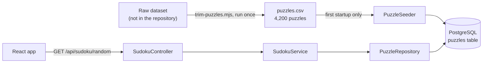

# Sudoku

A full-stack Sudoku game: a Spring Boot API serves random puzzles from a PostgreSQL database, and a React app draws the board and checks the rules in the browser.

<p align="center"></p>

## Why this project exists

I started Sudoku on my own after the object-oriented programming module of the CodeCool course, to practise modelling a problem with rules instead of following an assignment. As the course moved on to Spring Boot and databases, I kept extending it into a full-stack app.

My other portfolio projects cover authentication and deployment. This one is where I practise data handling and design decisions, so those get the most space below. It is still in progress; the [Roadmap](#roadmap) lists what is missing.

## Features

- **A random puzzle on every page load**, picked by the database from 4,200 stored puzzles.
- **Playing:** click a cell and type 1 to 9; Backspace or Delete clears it. The given numbers cannot be changed. Clicking outside the board deselects.
- **Highlighting:** the selected cell's row, column and 3×3 box are tinted.
- **Conflict detection:** any other cell in that row, column or box holding the same number as the selected cell turns red.
- **Win detection:** once every cell is filled and nothing conflicts, the heading changes to "You solved it! Good job!".

## Tech stack

| Layer | Technology |
|---|---|
| Backend | Java 21, Spring Boot 4.1 (Web MVC, Spring Data JPA) |
| Database | PostgreSQL |
| Frontend | React 19, Vite 8, plain JavaScript |
| Tooling | Maven Wrapper, Node.js (dataset trimming script) |

## Architecture



The backend follows the usual controller → service → repository layering. Its job today is narrow: store the puzzles and hand one out. The game itself runs in the browser: the frontend turns the 81-character puzzle string into a 9×9 grid and applies the rules there.

```
backend/src/main/java/com/sudoku/backend/
  controller/   HTTP endpoints
  service/      picks a puzzle, maps entity to DTO
  repository/   Spring Data JPA queries
  entity/       PuzzleEntity, the database row
  dto/          PuzzleDTO, the API response
  seed/         PuzzleSeeder, CSV import on startup
  model/, util/ Board, Cell and a parser for the planned puzzle engine
frontend/src/
  components/   SudokuBoard, SudokuCell
  engine/       pure functions: puzzle parsing and rule checks
scripts/        trim-puzzles.mjs
```

## Design decisions

### The solution never leaves the server

`PuzzleEntity` holds both the puzzle and its solution. The API returns a `PuzzleDTO` (Data Transfer Object) with only `id`, `puzzle` and `clueNumber`. If the controller returned the entity directly, anyone could read the answer in the browser's network tab, and the API contract would change every time the table does.

### Win detection checks the rules, not the answer

Because the solution stays on the server, the frontend cannot compare the board against it. Instead `isSolved` checks what makes a Sudoku solved: no empty cells and no conflicts. A side benefit is that any valid completion is accepted, not only the stored one.

### Rules are pure functions, separate from components

`engine/validation.js` and `engine/puzzleParser.js` take a board and return a result, with no React in them. Conflicts are calculated during render from the current board and selection rather than stored in state, so they cannot get out of sync with the board. Board updates create new arrays instead of mutating the old ones.

### A trimmed, evenly spread dataset

The source dataset has millions of puzzles, far more than a game needs and too large to commit. `scripts/trim-puzzles.mjs` reads it as a stream, line by line, so the whole file is never in memory, and keeps the first 200 puzzles for each clue count from 25 to 45. That gives 21 × 200 = 4,200 puzzles spread evenly from hard (few clues) to easy (many clues), instead of whatever distribution the first rows of the raw file happen to have.

### Seeding at startup, exactly once

`PuzzleSeeder` implements `ApplicationRunner`, so it runs after the application context is ready. It returns early if the table already has rows, which makes restarts safe. It reads the CSV from the classpath rather than from a file path, so it also works when the app is packaged as a jar.

### Storage shape and game shape are different things

A database row stores a puzzle as an 81-character string: compact, and a `unique` constraint can stop duplicates. A game works on a 9×9 grid of cells that know whether they are fixed. I kept these as separate types (`PuzzleEntity` versus `Board` and `Cell`) instead of forcing one class to do both. At the moment the grid conversion happens on the frontend; the backend `Board`, `Cell` and `PuzzleParser` are groundwork for the puzzle engine on the roadmap and are not on the request path yet.

### Random selection in the database

`ORDER BY random() LIMIT 1` lets PostgreSQL pick the row. It sorts the whole table for every request, which is fine for 4,200 rows and would not be for millions. I chose the simple query knowingly for this size.

## Getting started

### Prerequisites

- JDK (Java Development Kit) 21
- Node.js 20.19+ or 22.12+ (required by Vite 8)
- PostgreSQL, running locally

### 1. Clone and create the database

```powershell
git clone https://github.com/bucystoni/sudoku-app.git
cd sudoku-app
psql -U postgres -c "CREATE DATABASE sudoku;"
```

The table is created automatically on first start.

### 2. Start the backend

The backend reads its database connection from three environment variables:

| Variable | Purpose | Example |
|---|---|---|
| `DB_URL` | JDBC connection URL | `jdbc:postgresql://localhost:5432/sudoku` |
| `DB_USERNAME` | Database user | `postgres` |
| `DB_PASSWORD` | That user's password | |

Windows (PowerShell):

```powershell
cd backend
$env:DB_URL = "jdbc:postgresql://localhost:5432/sudoku"
$env:DB_USERNAME = "postgres"
$env:DB_PASSWORD = "your-password"
.\mvnw.cmd spring-boot:run
```

macOS / Linux:

```bash
cd backend
export DB_URL=jdbc:postgresql://localhost:5432/sudoku
export DB_USERNAME=postgres
export DB_PASSWORD=your-password
./mvnw spring-boot:run
```

The API runs on `http://localhost:8080`. The first start imports the 4,200 puzzles; later starts skip the import.

### 3. Start the frontend

In a second terminal:

```powershell
cd frontend
npm install
npm run dev
```

Open `http://localhost:5173`. The backend only accepts browser requests from this address, so keep Vite on its default port.

## API reference

| Method | Path | Response |
|---|---|---|
| GET | `/api/sudoku/random` | `200` with a random puzzle |

```json
{
  "id": 1,
  "puzzle": "147000080095140630060000000006030854580700309039504100451603098908450063073908540",
  "clueNumber": 45
}
```

`puzzle` is the board read row by row, with `0` for an empty cell. If the table is empty the API answers `404` with a Problem Details body:

```json
{
  "type": "about:blank",
  "title": "Not Found",
  "status": 404,
  "detail": "Couldn't find random puzzle.",
  "instance": "/api/sudoku/random"
}
```

## Tests

```powershell
cd backend
.\mvnw.cmd test
```

There is one test so far, which checks that the Spring application context starts. It connects to the database, so the three environment variables must be set. Real test coverage is on the roadmap.

## Roadmap

- **Difficulty selection:** the repository already has a query for a clue-count range; it is not exposed through the API or the UI yet.
- **Puzzle engine in Java:** a solver engine, that can solve any valid sudoku board supplied by the user
- **Tests:** unit tests for the frontend rule functions and the backend service.
- **Frontend error handling:** if the backend is unreachable the page stays on "Loading..." with no message.
- **Deployement:** I plan on deploying the app once its ready so anyone can play.
- **Cleanup:** remove the scaffolding endpoints (`/api/hello`, `/api/sudoku/new`), the unused `Puzzle` record and the empty `isValidMove` stub.

## Author

Bučys Antanas ([@bucystoni](https://github.com/bucystoni))
